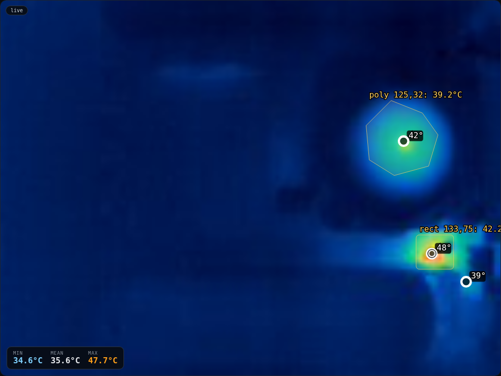
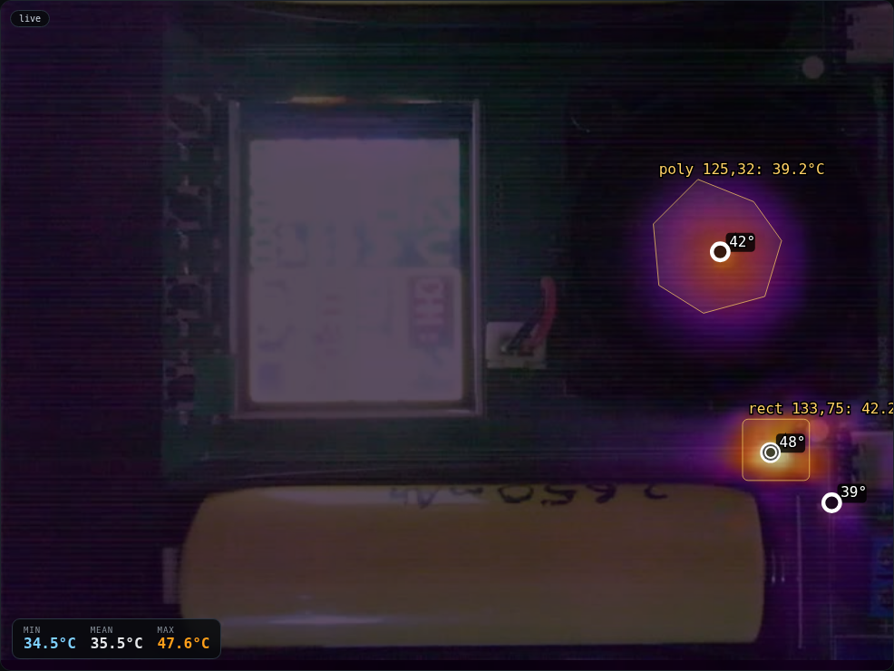
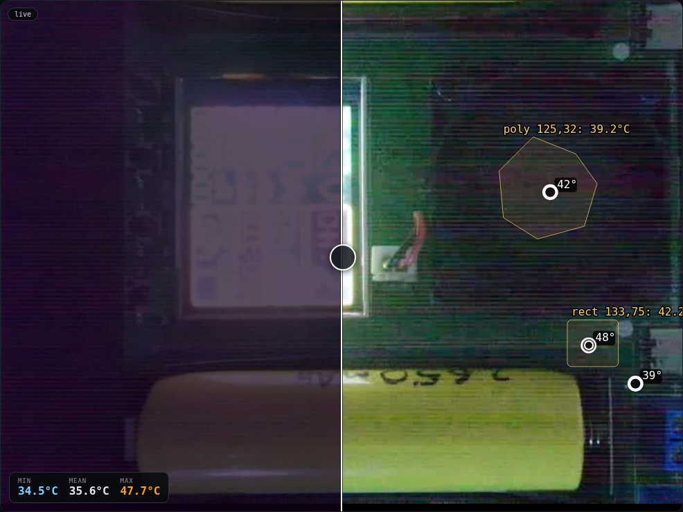

# ThermoLink

One web UI for thermal cameras, with the camera itself behind a driver boundary.

ThermoLink is the Rust port of [`qianli-supercam`](https://github.com/flip555/qianli-supercam).
The Python project proved the protocol and the interface; ThermoLink keeps the
features and removes the coupling — the web server never learns a camera's
resolution, packet layout, or network dialect. It asks a driver for a
`CameraSpec` and consumes `CameraFrame`s.

**Status:** the single-camera relay is feature-complete: live thermal and visible
feeds, measurement, alarms, snapshots, pre-record, roles, HTTPS, i18n, and
runtime driver hot-swap. A P3/P1 USB driver uses `nusb` for transport, with the
protocol and calibration ported; hardware validation is still pending.

## A look at it

| Thermal | Fusion (70% thermal) | Wipe |
|---|---|---|
|  |  |  |

## Features

- **Thermal:** palette rendering, clip/span bands, isotherm bands + profiles,
  hot/cold peaks, temperature history, point/box/polygon measurement, ΔT against
  a reference, A/B reference comparison.
- **Visible:** H.264 Annex-B → WebCodecs in the browser over HTTPS, with MJPEG
  transcoding as the fallback; Visible, Wipe, PiP and Fusion modes.
- **Drivers:** Qianli SuperCam over TCP, simulated source, and an offline
  P3/P1 USB driver entry (nusb; hardware validation pending). Drivers advertise capabilities; the GUI
  hides controls a camera cannot use, and drivers can be switched at runtime.
- **Operations:** snapshots (JPEG/raw/JSON + saved visible frame), pre-record
  ring buffer, per-clip ZIPs, alarm events, CSV exports, self-update/restart,
  health/uptime.
- **Re-analysis:** snapshots open as a stored view in the main window — thermal
  re-rendered with current palette/bands, saved visible frame, stored peaks and
  regions, with Wipe/PiP/Fusion/alignment still active; Exit returns to live.
- **Access:** Argon2 account, admin/guest roles with per-capability permissions,
  persisted sessions, Bearer and query tokens, self-signed HTTPS on `:8443`.
- **UI:** nine languages, RTL Arabic, fullscreen, responsive layout.

## Quick start

```bash
cargo build --release

# run the whole app against the simulator — no camera required
./target/release/thermolink serve --demo --bind 0.0.0.0:8099

# real Qianli camera
RUST_LOG=thermolink=info ./target/release/thermolink serve \
  --host 192.168.1.64 --bind 0.0.0.0:8099

# inspect a camera without starting the server
./target/release/thermolink probe --host 192.168.1.64
```

Open `http://<host>:8099` (HTTP) or `https://<host>:8443` (self-signed TLS,
generated on first start). The first visitor creates the admin account.

`serve` flags: `--driver`, `--host`, `--control-port`, `--media-port`, `--bind`,
`--demo`, `--data-dir`.

## Drivers

| id | transport | thermal | visible | notes |
|----|-----------|---------|---------|-------|
| `qianli` | TCP 3001/3000 | 160×120 | 1920×1080 H.264 | full handshake, settings, reboot, discovery |
| `p3` | USB | 256×192 / 160×120 | — | nusb transport + parser + calibration; hardware validation pending |
| `mock` | in-process | 160×120 | — | simulator for development and tests |

The GUI **Camera → Driver** selector persists `camera.json` and hot-swaps the
driver without restarting the relay. Capabilities are advertised in
`/api/spec`; the UI hides modes and controls that do not apply.

## Data directory

Everything stateful lives in `--data-dir` (default `thermolink-data/`):

```
auth.json  sessions.json  calibration.json  display.json  align.json
regions.json  alarms.json  references.json  reference-active.json
isotherm.json  camera.json  prerecord.json  notifications.json
snapshots/  captures/  tls-cert.pem  tls-key.pem
```

Back up the directory to preserve accounts, measurements, references and
recordings. Sessions are persisted, so a relay restart does not sign you out.

## Documentation

- [Architecture](docs/ARCHITECTURE.md)
- [Drivers and capabilities](docs/DRIVERS.md)
- [HTTP API](docs/API.md)
- [Security](docs/SECURITY.md)
- [Deployment](docs/DEPLOYMENT.md)
- [Troubleshooting](docs/TROUBLESHOOTING.md)
- [Qianli protocol notes](docs/PROTOCOL.md)

A ready-to-publish GitHub wiki lives in [`wiki/`](wiki/Home.md).

## Security notes

HTTPS uses a self-signed certificate; the browser warning is expected. The
session cookie is deliberately **not** marked `Secure` while the certificate is
self-signed (some browsers drop it on cert-error origins); the page also stores
the session token and sends it as `Authorization: Bearer`. See
[Security](docs/SECURITY.md) before exposing the relay to an untrusted network.

## Tests

```bash
cargo test --release --lib
```

The suite covers the Qianli protocol/thermal extraction, render paths, auth,
persistence, update logic, the P3 frame parser, and server helpers. The Qianli
integration test needs a local mock handshake server and runs in the same suite.

## License

MIT. See [LICENSE](LICENSE).
