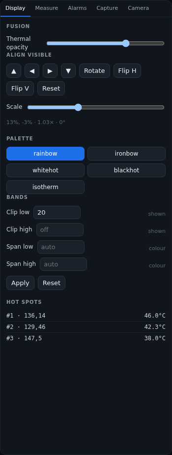
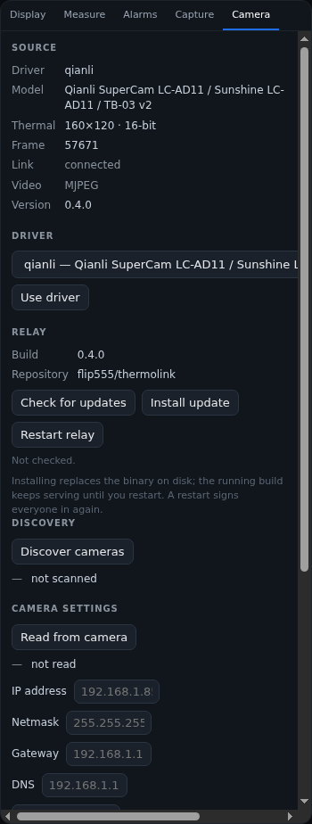

# Configuration

## CLI

```text
thermolink serve [--driver qianli] [--host 192.168.1.64]
                 [--control-port 3001] [--media-port 3000]
                 [--bind 0.0.0.0:8099] [--demo]
                 [--data-dir thermolink-data]
```

`--demo` forces the simulated driver. `RUST_LOG=thermolink=info` enables logs.

## Data directory

Everything stateful lives in `--data-dir`:

```text
auth.json  sessions.json  calibration.json  display.json  align.json
regions.json  alarms.json  references.json  reference-active.json
isotherm.json  camera.json  prerecord.json  notifications.json
snapshots/  captures/  tls-cert.pem  tls-key.pem
```

Back it up; it contains accounts, measurements, recordings and the TLS key.
Sessions persist across restarts.

## Camera selection

`camera.json` stores the selected driver and its connection fields. The GUI
(**Camera → Driver**) writes it and hot-swaps the running supervisor. On boot
the file overrides the `--driver/--host` defaults.

## Live settings

`display.json` (palette, clip/span, ΔT span), `align.json` (visible
offset/scale/flip/rotation), `calibration.json` (scale/offset),
`isotherm.json` (bands and profiles), `regions.json`, `alarms.json`,
`references.json` and `notifications.json` are written atomically by the app.

## HTTPS

The certificate is generated for `172.20.1.85`, `172.20.5.127`, `127.0.0.1`
and `localhost`. Replace the files or put a trusted reverse proxy in front for a
public deployment.

## Panels at a glance



The **Display** panel owns palette, bands, alignment, scale and hot spots.



The **Camera** panel shows source/driver details, relay update controls,
discovery and the camera network block (when the driver advertises it).
