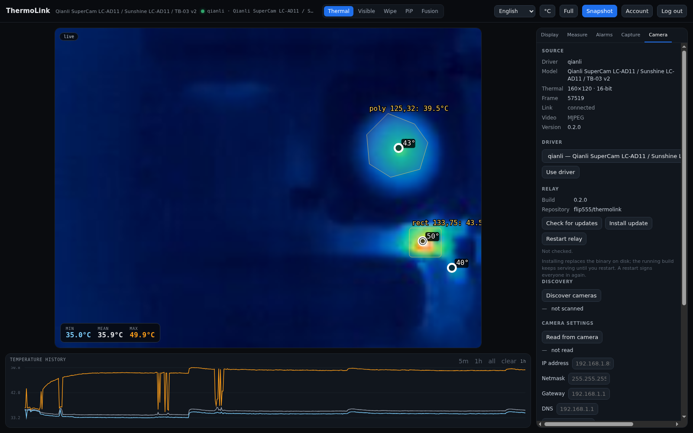

# Drivers

| id | transport | thermal | visible | status |
|----|-----------|---------|---------|--------|
| `qianli` | TCP 3001/3000 | 160×120 | 1920×1080 H.264 | full |
| `p3` | USB | 256×192 / 160×120 | — | nusb transport + parser; hardware validation pending |
| `uvc_radiometric` | USB/UVC (Linux) | 160×120–384×288 | — | TC001/P2 Pro/TC002C/HT301/T2S+/Mini2 + generic; **experimental** |
| `mock` | in-process | 160×120 | — | simulator |

A driver owns transport, framing, pixels and calibration. The server consumes
`CameraSpec` and `CameraFrame`; it never imports a concrete driver.

## Capabilities

`CameraSpec.capabilities` advertises thermal, visible, discovery, network
settings, reboot, radiometric calibration and a controls list. The UI hides
modes and fields that do not apply; the API still validates. A P3 therefore
shows no video modes, and `uvc_generic` hides temperature measurement.

## Hot-swap

`GET /api/drivers` lists compiled drivers. `POST /api/camera/select` with
`{"driver":"qianli","host":"192.168.1.64"}` stores `camera.json`, swaps the
`CameraRuntime` in an `ArcSwap`, and bumps a generation watch; the supervisor
closes the old session and opens the new one. No process restart.

For the UVC family, `GET /api/camera/detect` returns candidates and
`POST /api/camera/select` accepts `profile` and `device`. `0bda:5830` is shared
by several models; the result is marked ambiguous instead of guessing.

## Adding a driver

1. `src/camera/<family>/` implements `CameraDriver` + `CameraSession`.
2. Fill the spec and capabilities honestly.
3. Add one arm + id in `src/camera/registry.rs`.
4. Add protocol/parser tests; byte captures are ideal fixtures.

Full contract: [docs/DRIVERS.md](https://github.com/flip555/thermolink/blob/main/docs/DRIVERS.md).

## Camera tab

The Camera tab is capability-driven: driver selection and hot-swap are always
present; discovery, network settings and reboot appear only when the selected
driver advertises them.

The P3/P1 USB path uses `nusb` and needs the udev rule from
[Installation](Installation) or `docs/DEPLOYMENT.md`; hardware validation is
still pending.

The UVC path uses Linux V4L2 through ffmpeg. All new UVC profiles are
`tested: false`; see [docs/DRIVERS.md](https://github.com/flip555/thermolink/blob/main/docs/DRIVERS.md).

### Testing an unvalidated profile

1. Set **Camera → Driver** to `uvc_radiometric`.
2. Pick the closest profile; the dropdown shows `validated`,
   `ported — unvalidated`, `needs hardware` or `needs research`.
3. Click **Use driver**.
4. If it works or fails, click **Report hardware / capture** and include the
   VID:PID, profile and a raw frame.

Ported protocol code is not validation; every UVC profile remains experimental
until a real unit and capture confirm the layout/calibration. The hardware
report issue form is the path to promoting one.
