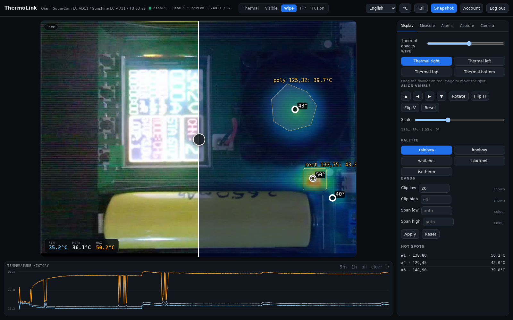
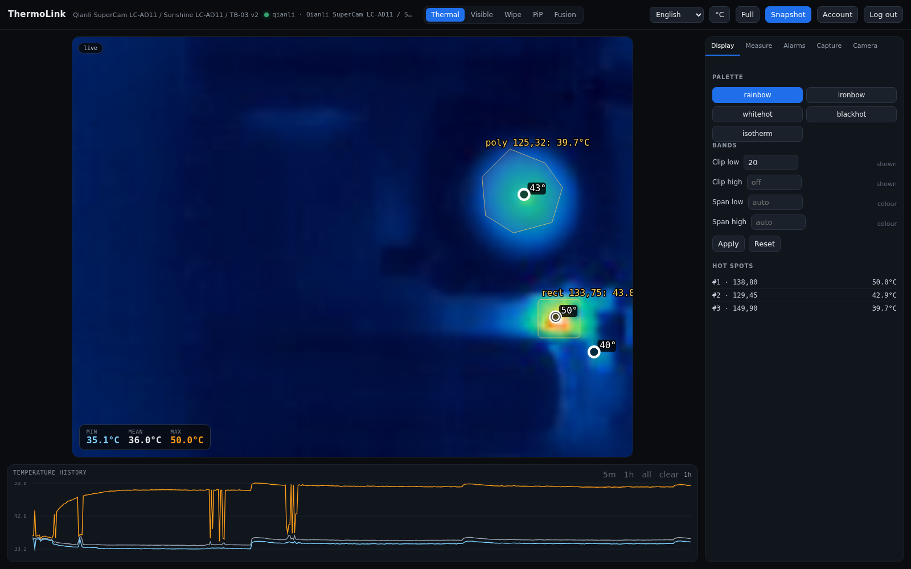
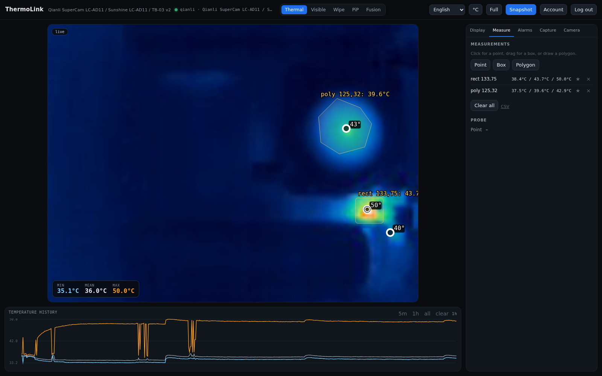
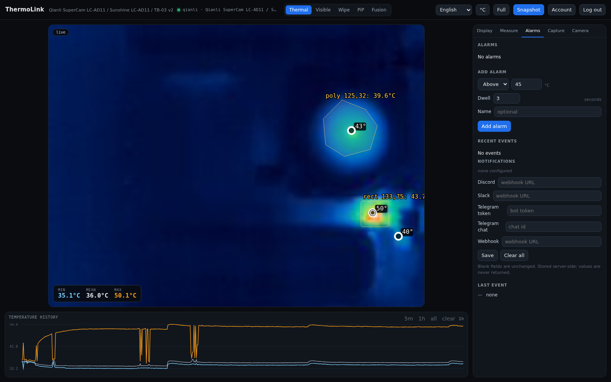
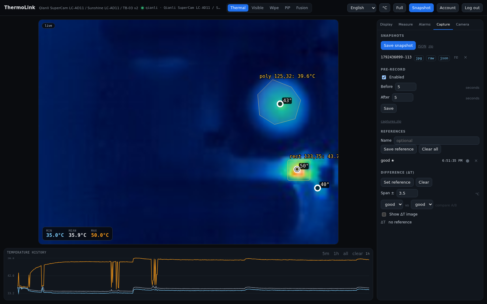
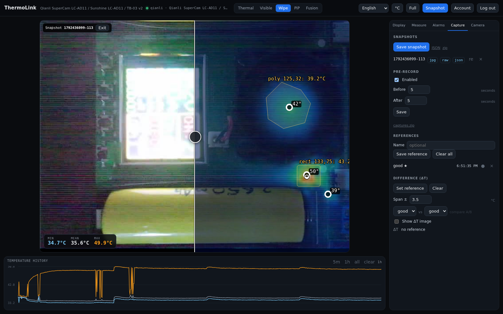
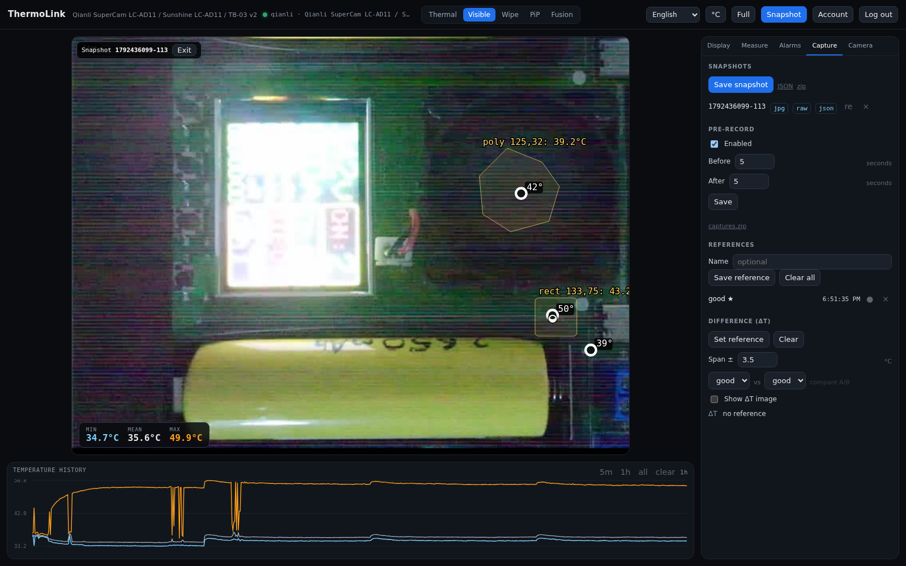
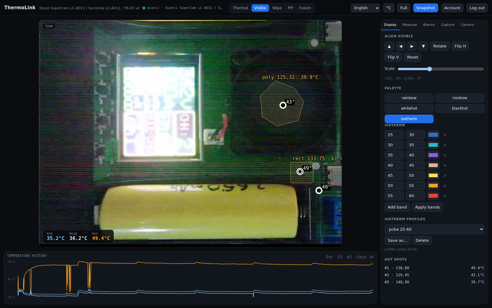

# Screenshots

Captures from the live UI against a Qianli SuperCam. Click an image to open it
full-size.

## Live thermal

Thermal mode with the **Display** tab open: rainbow palette, clip/span bands,
polygon and rectangle measurements, hot spots and the 5-minute temperature
history. The header shows driver, model, frame counter and link state.

## Wipe

Wipe mode with the thermal layer on the right. Drag the divider; the same tab
has the thermal-opacity slider, alignment nudges/rotation/flip, scale and
palette controls.

## Display and palettes

Palette buttons (rainbow, ironbow, white hot, black hot, isotherm), band
controls, applied/current values and the live hot-spot list.

## Measure

Point, box and polygon measurements. Each row keeps min/centre/max; **CSV**
exports the current table and **Clear all** removes them.

## Alarms

Add above/below alarms with a dwell time, then configure Discord, Slack,
Telegram or a webhook. **Recent events** and **Last event** show what fired.

## Capture and snapshots

Save a snapshot (JPEG, raw, JSON and visible still), enable pre-record, and
manage references. The **Difference (ΔT)** block sets the reference and span.

## Camera and relay

Source/driver details, frame counter and link state, driver selection, relay
update controls, discovery and the camera's network settings.

## Re-analysis

A saved snapshot reopened with **re** in Capture. The banner names the snapshot;
peaks, measurements and history are the stored values. **Exit** returns to live.

## Re-analysis with the saved visible frame

The same snapshot in **Wipe**, showing the thermal overlay and the saved visible
still. Palette, bands, wipe, fusion and alignment stay interactive.

The saved visible still on its own, with the stored thermal measurements drawn
on top.

## Difference against a reference

**Show ΔT image** against the activated `good` reference with a ±3.5 °C span.
The pink field is the difference; widen the span if it saturates.

## Isotherm

The isotherm palette with editable bands, colour swatches, **Add band** /
**Apply bands**, and saved profiles.
