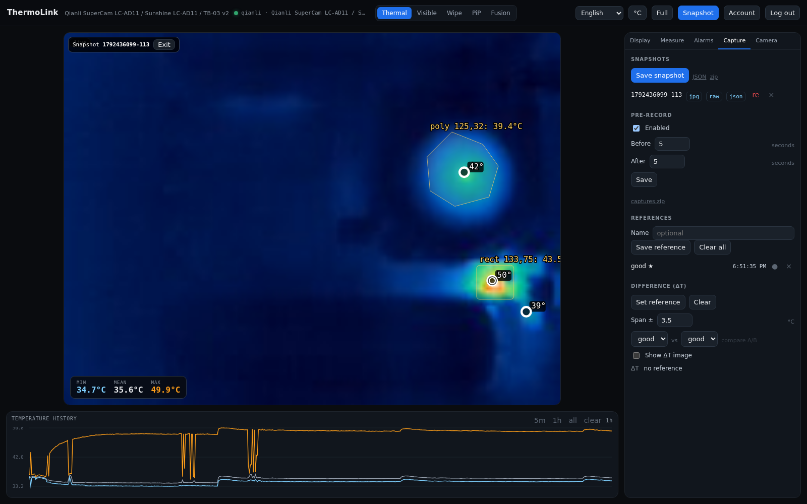
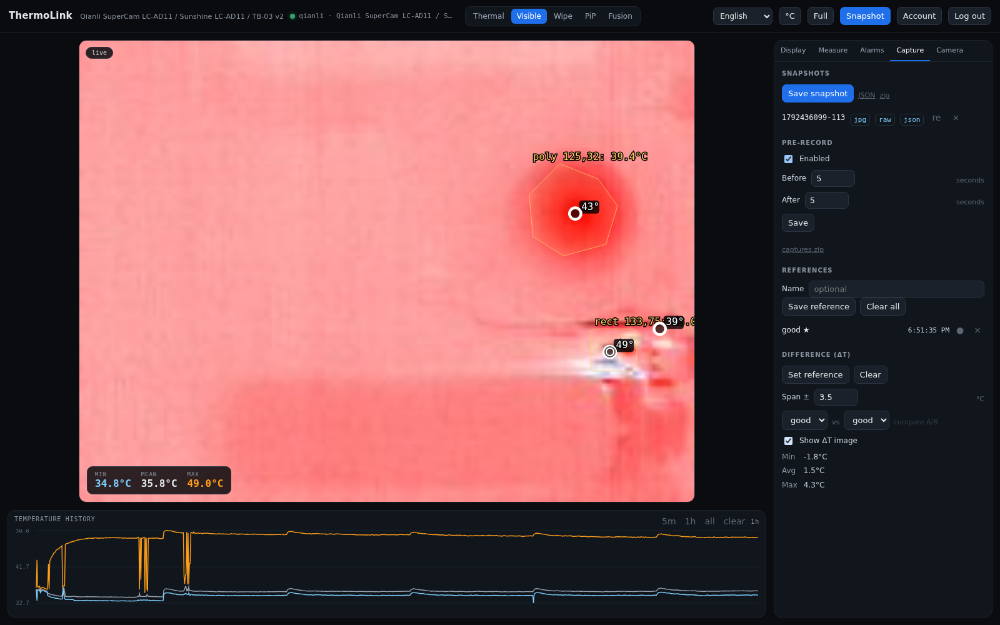

# Troubleshooting

## Login works but everything is 401

Hard-refresh; the page should store `thermolink.token` and send it as a Bearer
header. Log in again if the tab predates the token build. Use one hostname
consistently. Self-signed HTTPS must not use a `Secure` cookie.

## Visible feed blank

Check `ffmpeg`. Over HTTPS the page tries WebCodecs (`/api/raw.h264`); hover the
Video label for the fallback reason. Force MJPEG with `?mjpeg=1`.

## Image streams 401

`` cannot send headers; append `?token=<session>` to the stream URL.

## Chart empty

It needs at least two one-second samples. Check `ready: true` in
`/api/thermal.json`; the window buttons are 5m/1h/all.

## No thermal

Check `Camera → Source`, ping the camera, and try `thermolink probe --host …`.
Switch to `mock` to prove the UI path.

## P3 selected but no frames

The P3 transport is implemented with `nusb` but still needs hardware validation.
Check the udev rule/permissions, `dmesg` for USB errors, and the PID (P3 `0x45A2`,
P1 `0x45C2`). Switch back to `qianli` or `mock` to prove the UI path.

## Re-analysis visible frame missing / NaN peaks

Only snapshots taken after visible-frame capture have a `.vis` still; take a new
one. NaN peaks were a `celsius` vs `c` mapping bug, fixed in the current build.

## Disk full

`cargo clean --profile dev` frees the debug tree; prune `snapshots/` and
`captures/`.

Full detail: [docs/TROUBLESHOOTING.md](https://github.com/flip555/thermolink/blob/main/docs/TROUBLESHOOTING.md).

## Re-analysis and ΔT checks

If **re** opens a thermal-only view, that snapshot predates visible-still
capture; take a new snapshot. The banner and **Exit** confirm you are in the
stored view rather than live.

A saturated pink ΔT field is normal for a small span. Widen **Span ±** or
re-save the reference with the camera settled.
