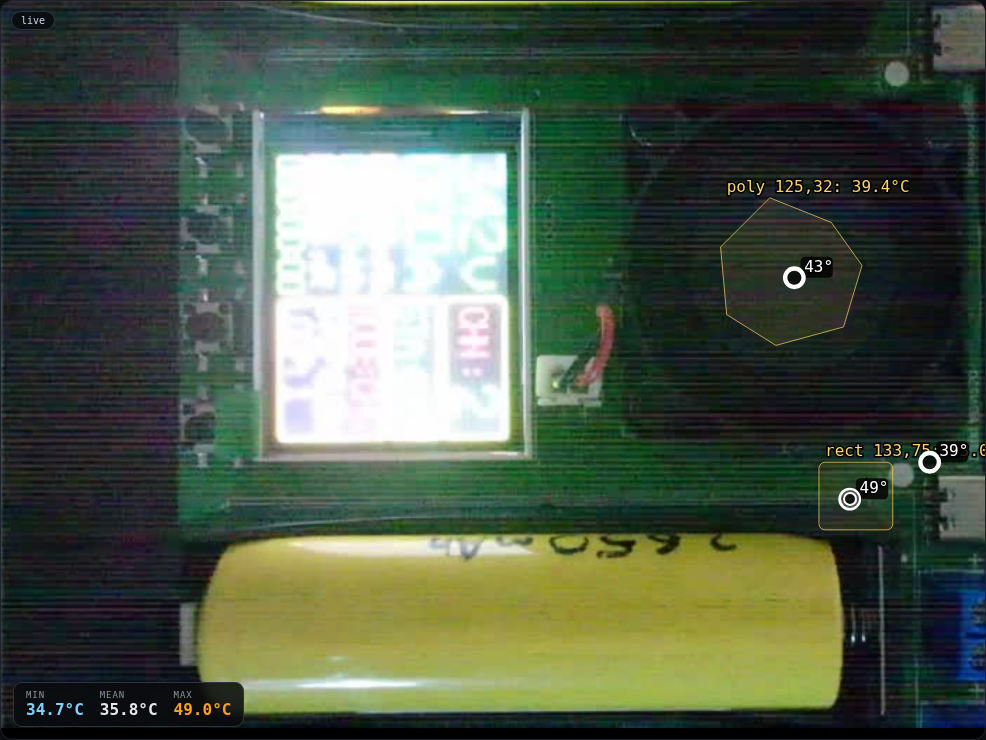
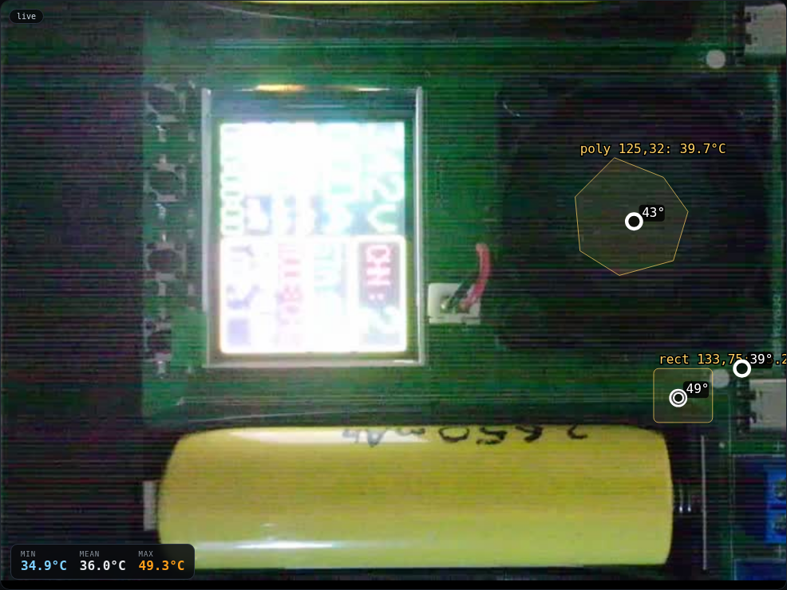
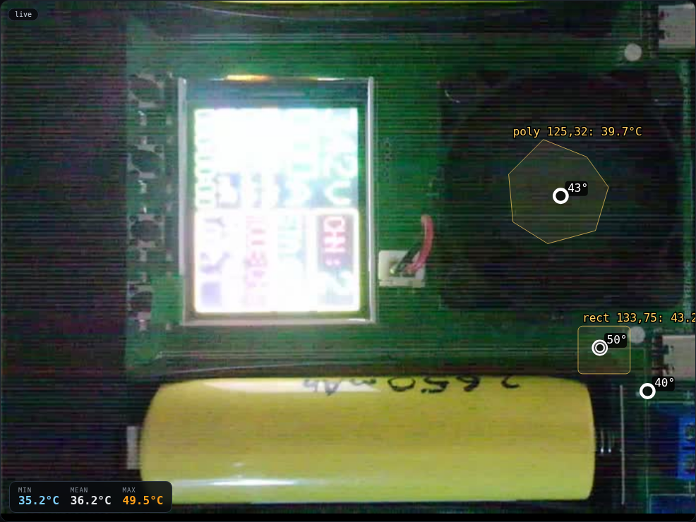
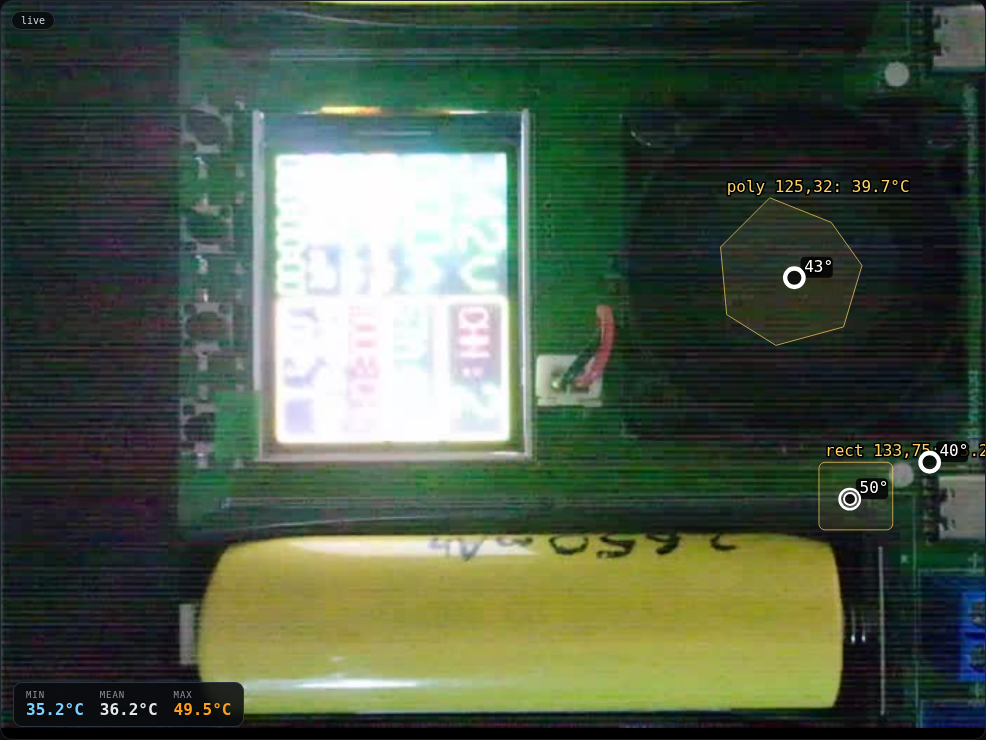
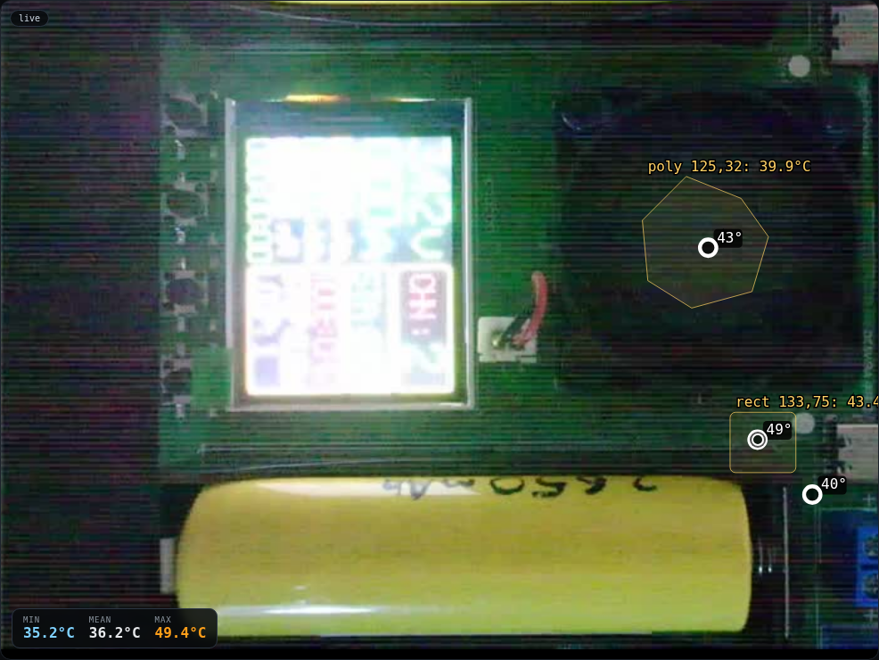
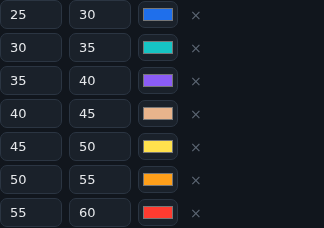
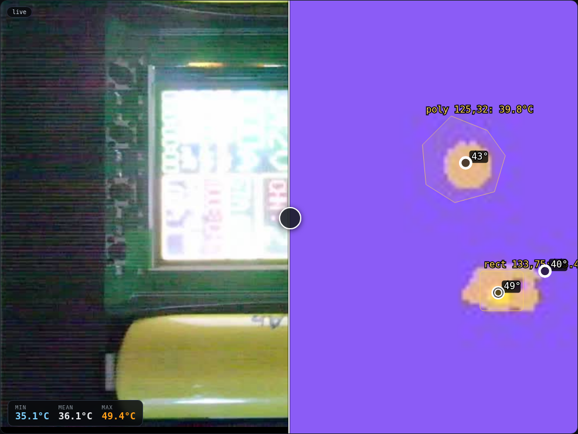
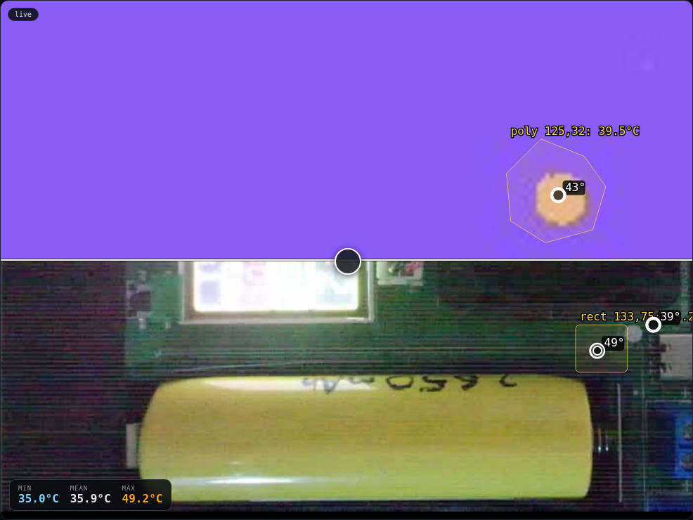
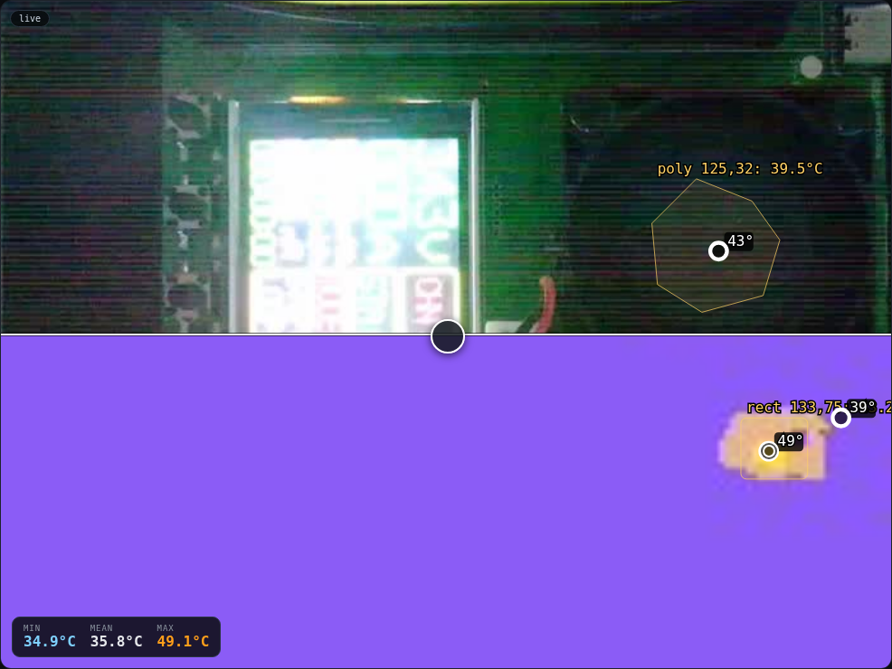
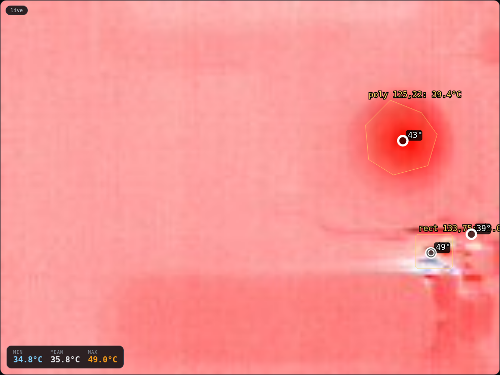

# Using the view

## Palettes

Pick a palette in **Display → Palette**. Clip/span bands only appear for the
non-isotherm palettes; the isotherm palette swaps them for band editing.

| Rainbow | Ironbow |
|---|---|
|  |  |

| White hot | Black hot |
|---|---|
|  |  |

## Isotherm

Select **isotherm**, then edit the bands (lo/hi/colour) and press **Apply bands**.
Save a named profile with **Save as…**; it is applied at startup.

## Wipe

Choose **Wipe**, pick which side is thermal, then drag the divider on the image.
The thermal-opacity slider blends the thermal layer with the visible feed.

| Thermal right | Thermal left |
|---|---|
|  |  |

| Thermal top | Thermal bottom |
|---|---|
|  |  |

## ΔT reference

1. In **Capture → References**, save the current frame with a name (for example `good`).
2. Press the **●** button on that reference to activate it.
3. Tick **Show ΔT image** and set the ± °C span.
4. The view now shows the difference against the stored reference; the stats and
   peaks refer to the live frame.

Snapshots can be re-opened with **re** in the Capture list. That enters a stored
view in the main window (thermal + saved visible frame), with the palette,
bands, wipe and fusion controls still active; **Exit** returns to live.
